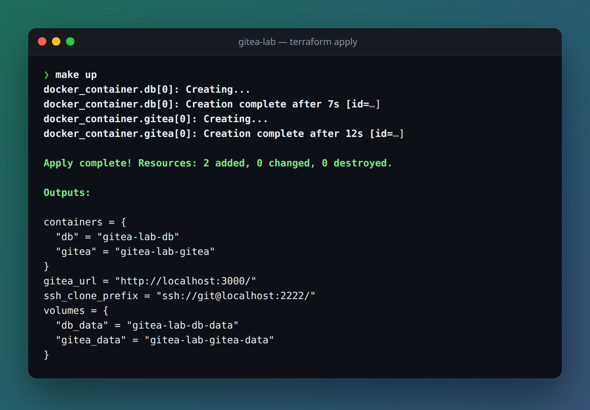
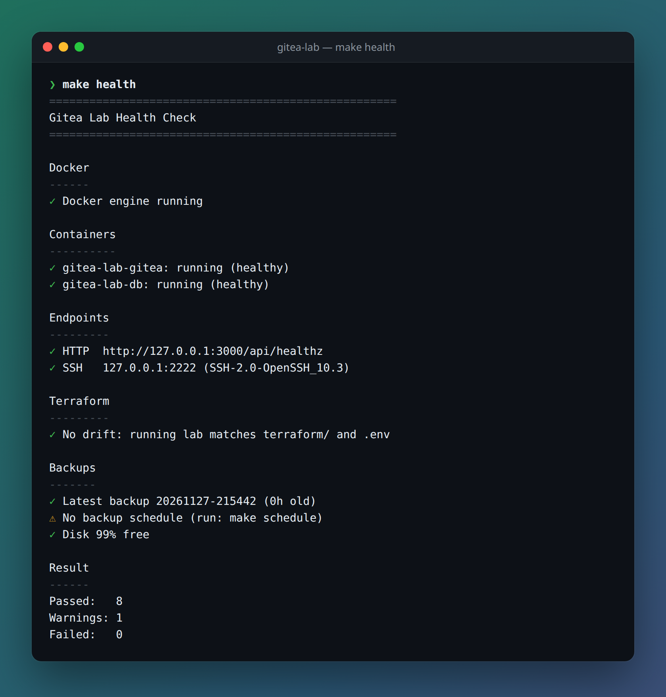
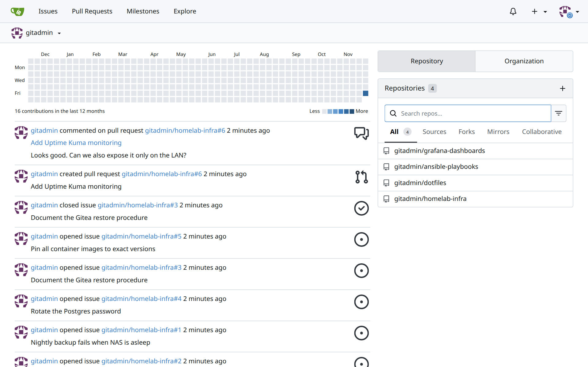
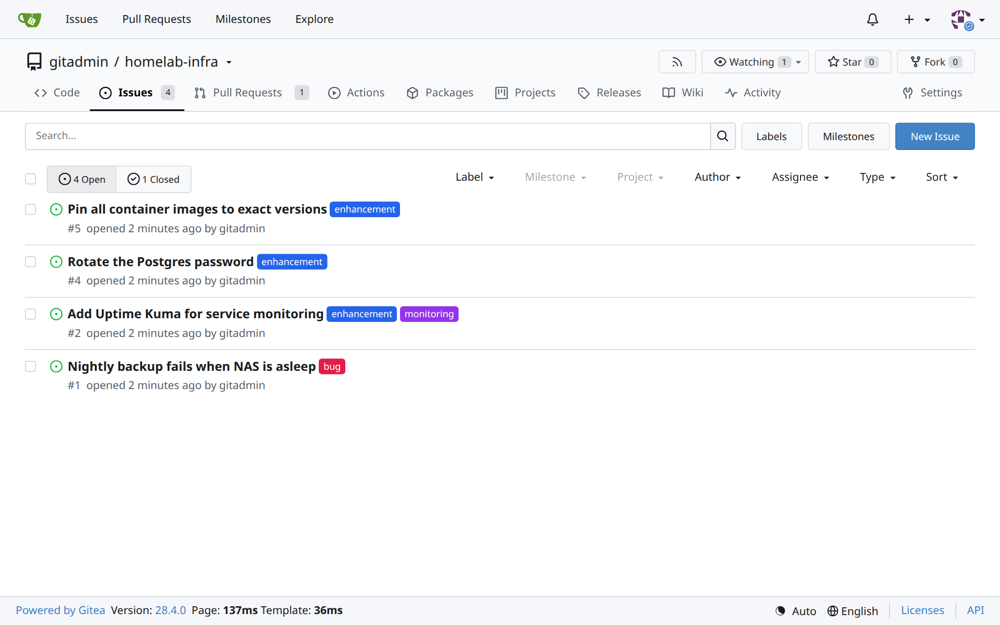
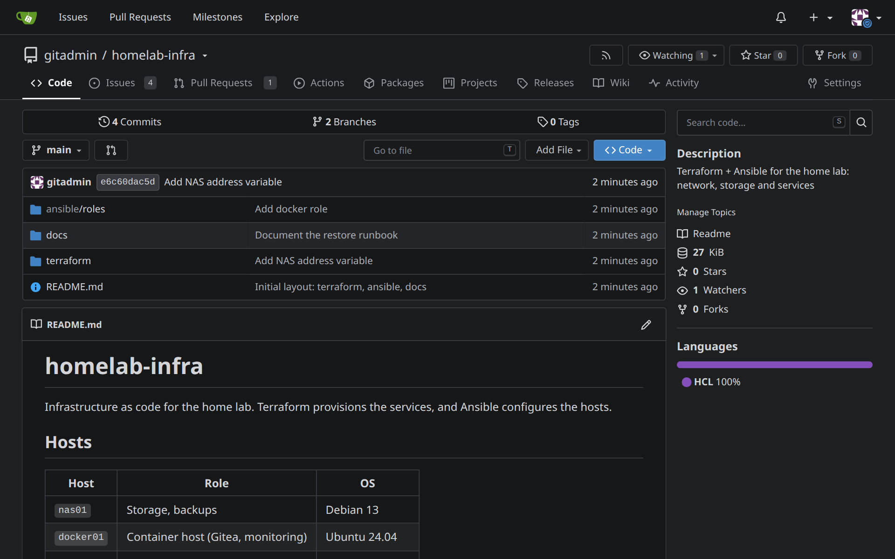
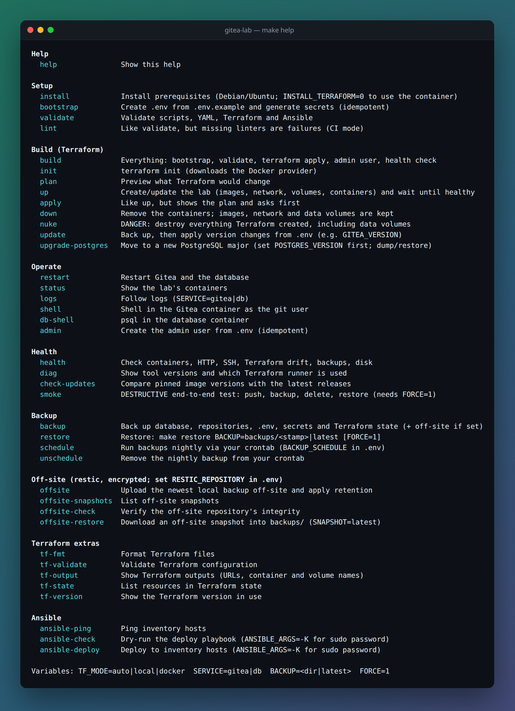

# Gitea Docker Lab

A self-hosted [Gitea](https://about.gitea.com/) Git server with PostgreSQL. **Terraform builds the whole stack** (images, network, volumes and containers) through the Docker provider, and a Makefile drives everything. Backup and restore are tested in CI.

```bash
make install   # once per machine (Debian/Ubuntu)
make build     # bootstrap → validate → terraform apply → admin user → health check
```

Terraform does **not** need to be installed. If it is missing, every Terraform step runs in the `hashicorp/terraform` container automatically.


---

## What you get

| Component | Details |
|---|---|
| Gitea | `docker.gitea.com/gitea:28.4.0`. Web UI on `:3000`, Git over SSH on `:2222` |
| PostgreSQL | `postgres:19-alpine`. Gitea is only created after the database is healthy. Major upgrades with `make upgrade-postgres` |
| Terraform | `terraform/`, `kreuzwerker/docker` provider. Runs locally or in a container (`TF_MODE`) |
| Secrets | Database password and `SECRET_KEY` in `secrets/` (mode 600), mounted read-only. **Never in Terraform state or `docker inspect`** |
| Backups | `pg_dump` + data volume + `.env` + secrets + state, with checksums and retention. Nightly via `make schedule` |
| Off-site | Optional encrypted copies with restic (local or NAS path, S3, B2, REST), tested with a full disaster-recovery drill |
| Health | Containers, HTTP, SSH, **Terraform drift**, backup and off-site age, schedule, disk |
| Updates | `make check-updates`, a weekly CI issue for new image versions, and Dependabot for Actions and the provider |
| Ansible | Deploys the lab to remote hosts (Terraform then runs on each host). Tested in CI with real `sudo` |
| CI | Lint, a live build/backup/restore/drift job, and an Ansible deploy that must be idempotent |

<p>
  
  
</p>

---

## Quick start

```bash
git clone <this repo> gitea-lab && cd gitea-lab
make install        # Docker, Ansible, linters, Terraform (INSTALL_TERRAFORM=0 to skip it)
make build
```

Open <http://localhost:3000> and sign in as `GITEA_ADMIN_USER` with the `GITEA_ADMIN_PASSWORD` that `make bootstrap` generated in `.env`.

Then protect your data:

```bash
make schedule      # nightly backup at 03:30 (BACKUP_SCHEDULE in .env)
# optional: set RESTIC_REPOSITORY in .env for encrypted off-site copies,
# and store secrets/restic_password somewhere other than this machine
```

### How Terraform is used

`.env` is the only file you edit. [`scripts/tf.sh`](scripts/tf.sh) passes its values to Terraform as `TF_VAR_*` variables and runs Terraform in one of three modes:

```bash
make up                   # local terraform if installed, else the container
make up TF_MODE=docker    # always use hashicorp/terraform:${TERRAFORM_VERSION}
make up TF_MODE=local     # require a local install
make diag                 # shows which runner is in use
```

In container mode the Docker socket is mounted, and Terraform runs as your user, so both modes read and write the same `terraform/terraform.tfstate`. CI checks this: after a local apply, the container's `plan` must report no changes.

| Target | Terraform action |
|---|---|
| `make up` | `apply -auto-approve`: create or update everything and wait for health checks |
| `make apply` | Same as `up`, but shows the plan and asks first |
| `make plan` | Preview changes, e.g. after bumping `GITEA_VERSION` in `.env` |
| `make down` | `apply -var running=false`: remove the containers but **keep the data volumes** |
| `make nuke` | `destroy`: everything, including the data volumes (asks for confirmation) |

---

## Screenshots

| | |
|---|---|
|  |  |
| Dashboard | Issues with labels |
|  |  |
| Pull request | Dark theme (follows your OS setting) |
|  |  |
| `make help` | `make backup` |

More in [docs/screenshots](docs/screenshots).

---

## Make targets

Run `make help` for the full list.

| Area | Targets |
|---|---|
| Setup | `install` `bootstrap` `validate` `lint` |
| Build (Terraform) | `build` `init` `plan` `up` `apply` `down` `nuke` `update` `upgrade-postgres` |
| Operate | `status` `logs [SERVICE=gitea\|db]` `restart` `shell` `db-shell` `admin` |
| Health | `health` `diag` `check-updates` `smoke FORCE=1` |
| Backup | `backup` `restore BACKUP=<dir\|latest> [FORCE=1]` `schedule` `unschedule` |
| Off-site | `offsite` `offsite-snapshots` `offsite-check` `offsite-restore [SNAPSHOT=]` |
| Terraform extras | `tf-fmt` `tf-validate` `tf-output` `tf-state` `tf-version` |
| Ansible | `ansible-ping` `ansible-check` `ansible-deploy [ANSIBLE_ARGS=-K]` |

---

## Configuration

Everything lives in `.env`, which `make bootstrap` creates from [.env.example](.env.example).

| Key | Purpose |
|---|---|
| `LAB_NAME` | Prefix for container, network and volume names (`gitea-lab-gitea`, …) |
| `GITEA_VERSION`, `POSTGRES_VERSION`, `TERRAFORM_VERSION` | Pinned image tags. Bump them, then run `make update` |
| `GITEA_HTTP_BIND` / `GITEA_HTTP_PORT` | Use `127.0.0.1` to keep the web UI off your LAN |
| `GITEA_SSH_PORT` | Host port for Git over SSH |
| `GITEA_ROOT_URL`, `GITEA_DOMAIN` | Set these when Gitea sits behind a reverse proxy or a real hostname |
| `GITEA_DISABLE_REGISTRATION` | `true` by default. The admin creates users |
| `BACKUP_KEEP`, `BACKUP_STOP_GITEA`, `BACKUP_SCHEDULE`, `BACKUP_NOTIFY_URL` | Retention, consistency mode, schedule, and an alert URL for failed backups |
| `RESTIC_REPOSITORY`, `OFFSITE_KEEP` | Off-site target (empty = off) and its retention |

Variables already set in your shell override `.env`, for example `BACKUP_STOP_GITEA=0 make backup`.

**Secrets.** `make bootstrap` generates three files in `secrets/` (directory 700, files 600, gitignored):

| File | Used for |
|---|---|
| `postgres_password` | Database password, mounted read-only into both containers |
| `gitea_secret_key` | Gitea's `SECRET_KEY`, which encrypts 2FA secrets and tokens |
| `restic_password` | Encryption key for off-site backups. **Keep a copy off this machine** |

Terraform only ever receives the path to `secrets/`, so the state file contains no passwords. Labs created before this change are migrated automatically: `make bootstrap` moves the values out of `.env` and keeps them unchanged.

---

## Documentation

- [Architecture](docs/architecture.md)
- [Operations](docs/operations.md)
- [Backup and restore](docs/backup-restore.md)
- [Monitoring](docs/monitoring.md)

## License

[MIT](LICENSE)
