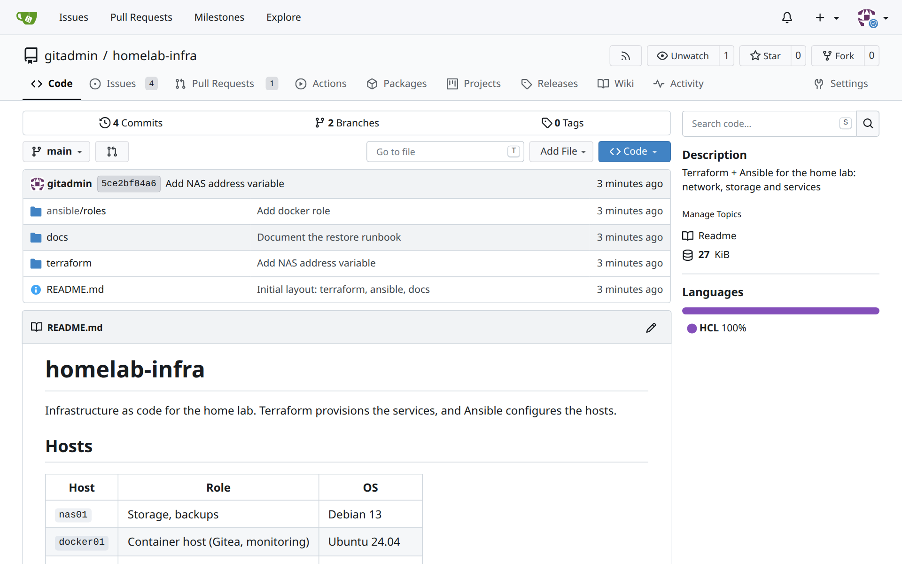
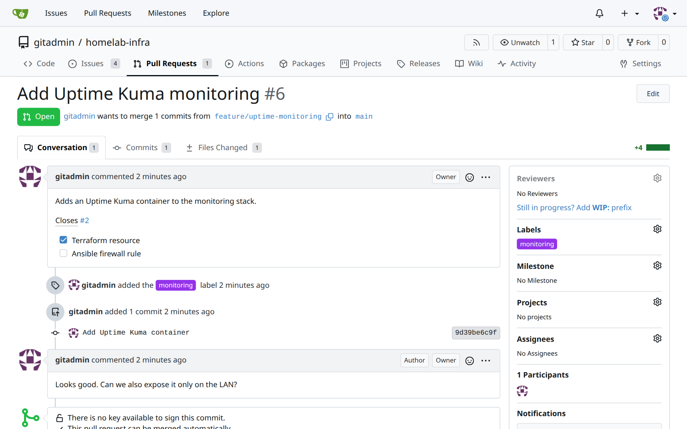
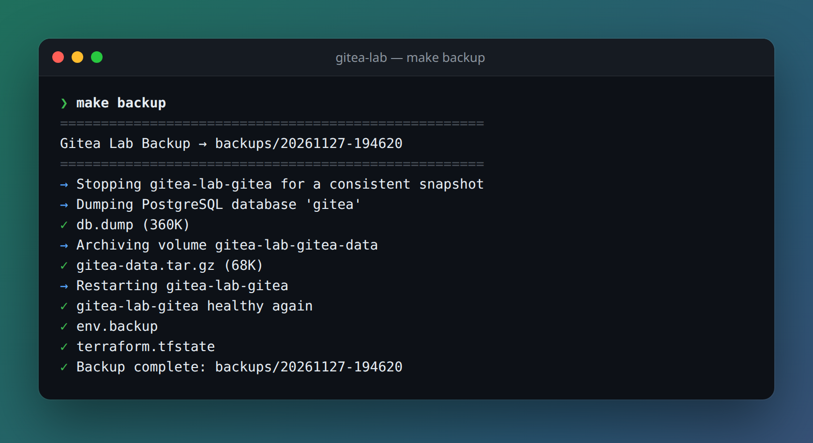

# Gitea Docker Lab

A self-hosted [Gitea](https://about.gitea.com/) Git server with PostgreSQL. **Terraform builds the whole stack** (images, network, volumes and containers) through the Docker provider, and a Makefile drives everything. Backup and restore are tested in CI.

```bash
make install   # once per machine (Debian/Ubuntu)
make build     # bootstrap → validate → terraform apply → admin user → health check
```

Terraform does **not** need to be installed. If it is missing, every Terraform step runs in the `hashicorp/terraform` container automatically.



---

## What you get

| Component | Details |
|---|---|
| Gitea | `docker.gitea.com/gitea:1.27.3`. Web UI on `:3000`, Git over SSH on `:2222` |
| PostgreSQL | `postgres:17-alpine`. Gitea is only created after the database is healthy |
| Terraform | `terraform/`, `kreuzwerker/docker` provider. Runs locally or in a container (`TF_MODE`) |
| Backups | `pg_dump` + data volume archive + `.env` + Terraform state, with checksums and retention |
| Health | Containers, HTTP, SSH, **Terraform drift**, backup age, disk |
| Ansible | Deploys the lab to remote hosts (Terraform then runs on each host) |
| CI | ShellCheck, yamllint, Terraform, Ansible, then a real build, backup, restore and drift check |

<p>
  
  
</p>

---

## Quick start

```bash
git clone <this repo> gitea-lab && cd gitea-lab
make install        # Docker, Ansible, linters, Terraform (INSTALL_TERRAFORM=0 to skip it)
make build
```

Open <http://localhost:3000> and sign in as `GITEA_ADMIN_USER` with the `GITEA_ADMIN_PASSWORD` that `make bootstrap` generated in `.env`.

### How Terraform is used

`.env` is the only file you edit. [`scripts/tf.sh`](scripts/tf.sh) passes its values to Terraform as `TF_VAR_*` variables and runs Terraform in one of three modes:

```bash
make up                   # local terraform if installed, else the container
make up TF_MODE=docker    # always use hashicorp/terraform:${TERRAFORM_VERSION}
make up TF_MODE=local     # require a local install
make diag                 # shows which runner is in use
```

In container mode the Docker socket is mounted, and Terraform runs as your user, so both modes read and write the same `terraform/terraform.tfstate`. CI checks this: after a local apply, the container's `plan` must report no changes.

| Target | Terraform action |
|---|---|
| `make up` | `apply -auto-approve`: create or update everything and wait for health checks |
| `make apply` | Same as `up`, but shows the plan and asks first |
| `make plan` | Preview changes, e.g. after bumping `GITEA_VERSION` in `.env` |
| `make down` | `apply -var running=false`: remove the containers but **keep the data volumes** |
| `make nuke` | `destroy`: everything, including the data volumes (asks for confirmation) |

---

## Screenshots

| | |
|---|---|
|  |  |
| Dashboard | Issues with labels |
|  |  |
| Pull request | Dark theme (follows your OS setting) |
|  |  |
| `make help` | `make backup` |

More in [docs/screenshots](docs/screenshots).

---

## Make targets

Run `make help` for the full list.

| Area | Targets |
|---|---|
| Setup | `install` `bootstrap` `validate` `lint` |
| Build (Terraform) | `build` `init` `plan` `up` `apply` `down` `nuke` `update` |
| Operate | `status` `logs [SERVICE=gitea\|db]` `restart` `shell` `db-shell` `admin` |
| Health | `health` `diag` `smoke FORCE=1` |
| Backup | `backup` `restore BACKUP=<dir\|latest> [FORCE=1]` |
| Terraform extras | `tf-fmt` `tf-validate` `tf-output` `tf-state` `tf-version` |
| Ansible | `ansible-ping` `ansible-check` `ansible-deploy [ANSIBLE_ARGS=-K]` |

---

## Configuration

Everything lives in `.env`, which `make bootstrap` creates from [.env.example](.env.example).

| Key | Purpose |
|---|---|
| `LAB_NAME` | Prefix for container, network and volume names (`gitea-lab-gitea`, …) |
| `GITEA_VERSION`, `POSTGRES_VERSION`, `TERRAFORM_VERSION` | Pinned image tags. Bump them, then run `make update` |
| `GITEA_HTTP_BIND` / `GITEA_HTTP_PORT` | Use `127.0.0.1` to keep the web UI off your LAN |
| `GITEA_SSH_PORT` | Host port for Git over SSH |
| `GITEA_ROOT_URL`, `GITEA_DOMAIN` | Set these when Gitea sits behind a reverse proxy or a real hostname |
| `GITEA_DISABLE_REGISTRATION` | `true` by default. The admin creates users |
| `BACKUP_KEEP`, `BACKUP_STOP_GITEA` | Backup retention and consistency mode |

Secrets (`POSTGRES_PASSWORD`, `GITEA_SECRET_KEY`, `GITEA_ADMIN_PASSWORD`) are generated once and never overwritten. `.env` and the Terraform state (which also holds these secrets) are kept at mode `600` and are gitignored.

---

## Documentation

- [Architecture](docs/architecture.md)
- [Operations](docs/operations.md)
- [Backup and restore](docs/backup-restore.md)
- [Monitoring](docs/monitoring.md)

## License

MIT
