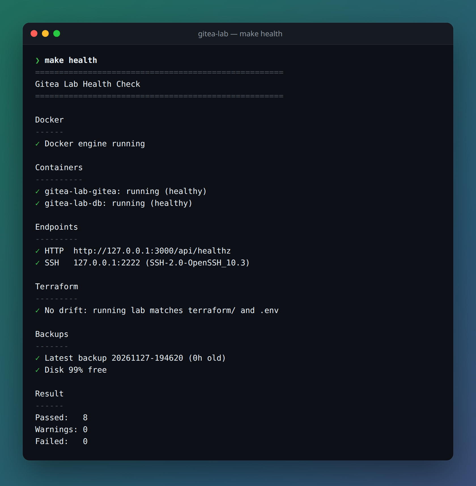

# Monitoring



## Built in

`make health` (`scripts/healthcheck.sh`) exits non-zero if any check fails, so cron or an external monitor can call it.

| Check | Fails / warns when |
|---|---|
| Docker engine | daemon not reachable |
| Containers | `<LAB_NAME>-gitea` or `<LAB_NAME>-db` missing, stopped or unhealthy |
| HTTP | `http://127.0.0.1:${GITEA_HTTP_PORT}/api/healthz` does not return 200 |
| SSH | `127.0.0.1:${GITEA_SSH_PORT}` does not answer with an SSH banner |
| Terraform | running lab differs from `terraform/` + `.env` (warning; skip with `HEALTH_SKIP_TF=1`) |
| Backups | none yet, or the newest is older than 48 h (warning) |
| Disk | under 10% free (warning) |

Docker also checks the containers itself, using the `healthcheck` blocks in `terraform/main.tf`: `curl /api/healthz` for Gitea and `pg_isready` for Postgres. `make up` waits on these (`wait = true`), and `make status` shows them.

## Alerting from cron

```cron
*/5 * * * * cd /opt/gitea-lab && ./scripts/healthcheck.sh >/dev/null || curl -fsS -d "Gitea lab unhealthy on $(hostname)" https://ntfy.sh/<your-topic>
```

Any webhook works here, such as ntfy, a Slack incoming webhook or healthchecks.io.

## Going further

- **Uptime from outside:** point an external checker (Uptime Kuma, healthchecks.io) at `http://<host>:3000/api/healthz`.
- **Metrics:** Gitea can expose Prometheus metrics. Add `GITEA__metrics__ENABLED=true` and `GITEA__metrics__TOKEN=<secret>` to the Gitea container's `env` in `terraform/main.tf`, run `make up`, then scrape `/metrics` with that bearer token.
