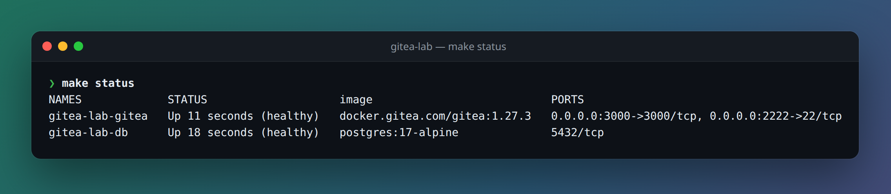
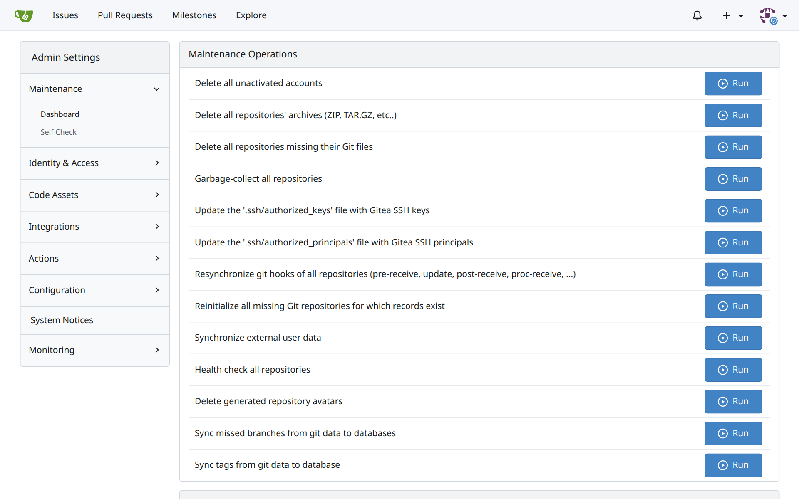

# Operations



## Day to day

| Task | Command |
|---|---|
| Start / converge | `make up` |
| Stop (keep data) | `make down` |
| Status | `make status` |
| Logs | `make logs` or `make logs SERVICE=db` |
| Health | `make health` |
| Shell in Gitea | `make shell` (then `gitea admin ...` commands) |
| SQL shell | `make db-shell` |
| What would change? | `make plan` |

## Changing settings

Edit `.env`, then run `make plan` to preview and `make up` to apply. Terraform replaces only the containers whose settings changed. The data volumes are never touched.

Example: to keep the web UI off the LAN, set `GITEA_HTTP_BIND=127.0.0.1`, then run `make plan` (one container replaced) and `make up`.

## Upgrading Gitea

`make check-updates` shows which pinned versions are behind. A weekly CI job also opens (or updates) a GitHub issue when something is out of date.

1. Read the [Gitea release notes](https://blog.gitea.com/) for breaking changes. Gitea moved from 1.x to a new numbering scheme after 1.27 (28.0.0, 28.1.0, …), so 1.27 → 28 is a major upgrade.
2. Set `GITEA_VERSION` in `.env` (and in `.env.example`, so new installs get it too).
3. Run `make plan` to confirm that only the Gitea image and container change.
4. Run `make update`. It takes a backup and then applies. Gitea runs its database migrations on startup.
5. `make health`

To roll back, set the old version, run `make up`, then `make restore BACKUP=<backup from step 4>`. Gitea migrations are not reversible, so restoring the backup is the only way back.

A **major** PostgreSQL upgrade (for example 17 → 18) needs a dump and restore, not just a new tag:

```bash
make backup
make nuke                      # removes the old data volume
# set POSTGRES_VERSION=18-alpine in .env
make up
make restore BACKUP=latest
```

## Rotating secrets

- **`gitea_secret_key`**: don't rotate it. Gitea uses it to encrypt stored 2FA secrets and tokens, and data encrypted with the old key becomes unreadable.
- **`postgres_password`**: change it inside Postgres first, then in the file, then restart both containers:
  ```bash
  new=$(openssl rand -hex 24)
  docker exec gitea-lab-db psql -U gitea -d gitea -c "ALTER USER gitea PASSWORD '$new';"
  printf '%s' "$new" > secrets/postgres_password
  make restart
  ```
- **`restic_password`**: use `restic key add` / `restic key remove` against the repository, not a new file.

## Users

Registration is off by default (`GITEA_DISABLE_REGISTRATION=true`). Create users in **Site Administration › User Accounts**, or from the CLI:

```bash
docker exec -u git gitea-lab-gitea gitea admin user create --username alice --email alice@example.com --random-password
```



## Deploying to another host (Ansible)

1. Add the host to `ansible/inventory/hosts.ini`, for example `gitea01 ansible_host=192.168.1.50 ansible_user=deploy`.
2. Run `make bootstrap` locally to create the `.env` that will be copied.
3. Run `make ansible-check ANSIBLE_ARGS=-K` (dry run), then `make ansible-deploy ANSIBLE_ARGS=-K`.

The role installs Docker if it's missing, copies the Makefile, scripts, Terraform files and `.env` to `/opt/gitea-lab`, and runs `make up` **on the host**. Terraform uses the host's own Docker engine there, and the host keeps its own state file. The role then waits for `/api/healthz` and creates the admin. Defaults are in `ansible/roles/project_host/defaults/main.yml`; overrides go in `ansible/inventory/group_vars/all.yml`.

## Troubleshooting

| Symptom | Check |
|---|---|
| `make up` times out waiting for health | `make logs`. A changed `secrets/postgres_password` after the database volume was created is the usual cause. The password is only applied on first creation (see "Rotating secrets"). |
| `make health` reports drift | `make plan` shows what differs. `make up` puts it back. |
| `permission denied ... docker.sock` | Your user isn't in the `docker` group. Run `make install`, then log in again. |
| Clone URLs show `localhost` | Set `GITEA_ROOT_URL` / `GITEA_SSH_DOMAIN` in `.env`, then run `make up`. |
| Files in volume owned by the wrong user | `USER_UID` / `USER_GID` in `.env` should match `id -u` / `id -g` |
